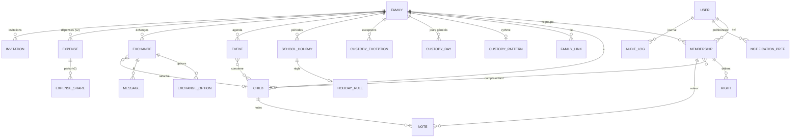

# Cahier des charges — CoParentPlanner

> **Destinataire : Claude Code.** Ce document est le contrat d'implémentation d'une application de coordination co-parentale. Il est organisé du *quoi* (vision, métier, fonctionnel) vers le *comment* (architecture, modèle de données, API), puis découpé en **lots/sprints** exécutables séquentiellement (§9). Chaque lot porte des critères d'acceptation. En cas d'ambiguïté, se référer aux maquettes HTML du bundle Claude Design (`CoParentPlanner Desktop.dc.html` et la variante mobile) qui font foi pour le rendu visuel.

---

## 0. Décisions d'architecture (validées)

| Sujet | Décision retenue | Notes |
|---|---|---|
| Backend | **Symfony 8.1 + API Platform 4 + Doctrine ORM + Mercure + Messenger** | Expose l'API (mobile) **et** héberge le front web |
| Front **web** | **Symfony UX** — server-rendered : **Twig + Turbo + Stimulus + AssetMapper** (aucun framework JS type React/Vue) | Recrée directement le médium HTML/CSS des maquettes |
| App **mobile** | **Flutter (Dart)** — iOS + Android | Consomme l'API via un client généré depuis l'OpenAPI |
| Génération de garde | **Matérialisation en base** d'un moteur de génération (rythme → jours), surchargée par exceptions/vacances | Alternative : calcul à la volée (impacte §2.4, §5 `CustodyDay`) |

Le **temps réel** est unifié via **Mercure** : Turbo Streams sur le web, SSE sur le mobile. Le reste du document (périmètre, métier, modèle de données, RGPD, découpage) est indépendant de ces choix.

---

## 1. Vision & périmètre

### 1.1 Pitch
CoParentPlanner aide les familles — **séparées** comme **unies** — à coordonner ce qui touche aux enfants : planning de garde, agenda d'activités, échanges/décisions communes, profils enfants, et (v2) partage des dépenses. Il se décline en **web responsive (PWA installable, server-rendered Symfony UX)** et en **app mobile Flutter (iOS/Android, offline riche)**, avec **synchronisation temps réel** entre co-parents.

### 1.2 Personae
- **Parent** : membre disposant de **tous les droits** sur sa/ses famille(s).
- **Beau-parent** : membre à **droits granulaires**, définis par les parents (lecture et/ou édition, par domaine).
- **Enfant** : membre à **droits limités**, définis par les parents (lecture seule par défaut, sur un sous-ensemble de domaines).
- **Administrateur** : un parent désigné gère les réglages de la famille et les invitations (rôle additionnel, cumulable avec « Parent »).

> Un même utilisateur peut appartenir à **plusieurs familles** et basculer entre elles (sélecteur de famille). Voir §2.1.

### 1.3 Périmètre v1 / v2

| Module | v1 | v2 |
|---|:--:|:--:|
| Authentification e-mail / mot de passe | ✅ | |
| Familles (séparée + unie), multi-famille, **familles liées + overlay** | ✅ | |
| Membres, rôles, droits granulaires (parent / beau-parent / enfant / admin), invitations e-mail | ✅ | |
| Profils enfants + notes partagées | ✅ | |
| Planning de garde (modèles, exceptions, vacances scolaires + import API officielle) | ✅ | |
| Agenda (événements, catégories, récurrence, filtres) | ✅ | |
| Échanges (discussions & décisions, fil de messages, **temps réel**) | ✅ | |
| Notifications **e-mail** | ✅ | |
| i18n (architecture multilingue ; **fr-FR** seule langue livrée) | ✅ | |
| PWA / offline | ✅ | |
| RGPD : chiffrement au repos, export/suppression, journalisation | ✅ | |
| **Dépenses partagées** (partages personnalisés + suivi des soldes) | | ✅ |
| Notifications **push mobile** | | ✅ |

### 1.4 Hypothèses & décisions notables
1. **Pas de données de santé.** Aucune catégorie de données de santé n'est créée. Les champs « informations » d'un enfant sont **libres** (label/valeur) ; les presets médicaux du prototype (« Allergies », « Médecin ») **ne sont pas repris**. Un **bandeau d'avertissement persistant** invite l'utilisateur à ne pas saisir de données de santé. *(Divergence assumée par rapport à la maquette.)*
2. **Marché France** : zones scolaires (A/B/C) et calendriers de vacances français. L'architecture est multilingue dès le départ (toutes les chaînes externalisées) mais seule la locale `fr-FR` est livrée.
3. **Greenfield** : aucun existant à reprendre.
4. Le **partage des dépenses** est masqué en v1 (l'onglet et le module n'apparaissent pas), mais le modèle de données réserve la place pour la v2 sans rupture.

---

## 2. Concepts métier (glossaire & règles)

### 2.1 Famille
- Deux **types** : `separated` (séparée) et `intact` (unie).
- Une famille **unie** : pas de planning de garde (onglet Garde masqué) ; partage des dépenses optionnel (v2).
- Une famille **séparée** : planning de garde actif.
- **Familles liées** : une famille peut être liée à une autre (typiquement le foyer recomposé de chaque parent). Quand deux familles sont liées, un membre habilité peut activer un **overlay** affichant en lecture seule les événements de la famille liée (pastilles d'activité, couleur dédiée `#9C6FB0`). **La garde n'est jamais modifiée par l'overlay.**
- Réglages : nom, type, modules activés, jour & heure d'échange de garde, fuseau (Europe/Paris par défaut), zone scolaire & académie.

### 2.2 Membre, rôles & droits (RBAC)
Un **Membre** lie un **Utilisateur** à une **Famille** avec un **rôle** et un jeu de **droits**.

Rôles :
- `parent` → tous les droits (non éditables).
- `step_parent` (beau-parent) → droits granulaires.
- `child` (enfant) → droits limités, définis par les parents ; **jamais** d'édition de structure (garde, membres, réglages), pas d'accès dépenses.
- `admin` → attribut booléen additionnel porté par un parent (gère réglages famille + invitations).

Domaines de droits (chacun : `none` | `view` | `edit`) :
| Domaine | parent | step_parent | child |
|---|---|---|---|
| `custody` (planning de garde) | edit | view/edit/none au choix | view/none |
| `agenda` (événements) | edit | view/edit/none au choix | view/none |
| `children_notes` (notes enfants) | edit | view/edit/none au choix | none (par défaut) |
| `expenses` (dépenses, v2) | edit | view/edit/none au choix | **none (forcé)** |
| `exchanges` (échanges) | edit | view/edit/none au choix | view/none |
| `family_settings` | edit (si admin) | none | none |

Règles :
- Le **dernier admin** d'une famille ne peut pas se retirer ni être rétrogradé.
- Un enfant-membre est **optionnellement** rattaché à un profil `Child` (son propre profil). Un profil enfant peut exister **sans** compte (cas courant des plus jeunes).
- L'attribution des droits d'un beau-parent ou d'un enfant se fait à l'invitation **et** est modifiable ensuite par un parent/admin.

### 2.3 Enfant (profil)
Sujet de la famille (pas nécessairement un compte). Champs : prénom, couleur d'avatar, initiale, date de naissance (→ âge calculé), niveau/établissement (libellé libre), **informations pratiques** (liste label/valeur libre : établissement, pointure, taille, dates clés…), **notes partagées** (auteur, date, texte). Bandeau d'avertissement « ne pas saisir de données de santé » affiché sur l'écran d'édition.

### 2.4 Planning de garde
S'applique aux familles **séparées** uniquement.

**Modèle de rythme** (`CustodyPattern`) :
- `alternating` — une semaine sur deux (7 jours par parent).
- `pattern_2_2_3` — 2 / 2 / 3 jours en rotation.
- `midweek_weekends` — jours fixes en semaine + week-ends alternés.
- `custom` — motif **nuit par nuit sur 2 semaines** (14 créneaux), chaque créneau = parent A ou B.
Paramètres communs : **date d'ancrage** (début du cycle), **jour d'échange** (ex. dimanche), **heure d'échange** (ex. 19h00). La transmission se fait le soir du jour d'échange.

**Génération** (moteur idempotent) :
1. À partir du modèle + ancrage, générer des enregistrements **`CustodyDay`** (un par jour, parent attribué) sur un **horizon glissant** (≈ 18 mois), régénérés à chaque modification du modèle.
2. Appliquer par-dessus, par priorité croissante :
   - **Règles de vacances** (`HolidayRule`) : pour chaque période de vacances scolaires, une règle (`alternating_weeks`, `split_50_50`, `fixed_parent`, `eve_alternating` pour les réveillons, etc.) qui **écrase** la base sur la période.
   - **Exceptions manuelles** (`CustodyException`) : échange ponctuel d'un jour ou d'une plage (priorité maximale), marquées visuellement « exceptionnel » (bordure pointillée).
3. Recalculer les **statistiques** (jours par parent sur la période affichée) à partir des `CustodyDay` effectifs.

**Vacances scolaires** : importées automatiquement depuis la source officielle (voir §4.7), par **zone** (A/B/C), **académie** et **année scolaire**. L'utilisateur peut ensuite affecter une règle à chaque période.

**Détail d'un jour** : chez quel parent, info de transmission (« Retour chez X le … 19h »), activités du jour, actions « Échanger ce jour » et « Modifier la garde ».

### 2.5 Événement / Agenda
Champs : titre, **catégorie** (`sport`, `musique`, `ecole`, `sante`, `autre` — couleurs en §8), **enfant(s)** concerné(s) (un ou plusieurs, ou « toute la famille »), **responsable** (un parent **ou un beau-parent** de la famille), date, heure, lieu (libellé libre), description optionnelle.
**Récurrence** : `none` | `weekly` | `biweekly` | `monthly`, avec date de fin ou nombre d'occurrences, et option **« exclure les vacances scolaires »**. Les occurrences sont matérialisées ou calculées (au choix d'implémentation, cohérent avec la garde).
Vues : liste « À venir » (accueil), agenda groupé par jour avec **filtres par catégorie**, et overlay des événements de la famille liée si activé.

### 2.6 Échange (discussion / décision)
Deux types :
- `discussion` — sujet ouvert, fil de messages, sans choix figé.
- `decision` — propose **2+ options** à trancher ; chaque membre habilité **choisit puis valide** ; statut passe à `decided` avec l'option retenue.
Champs : titre, corps, type, **rattachement** (un enfant **ou** « toute la famille »), **auteur**, **échéance** (date ; pour une décision, dépassement = signalé « en retard »), **statut** (`open` | `decided`), liste d'options (pour décision), **fil de messages** (auteur, texte, horodatage). Un compteur d'échanges ouverts s'affiche en badge de navigation. **Temps réel** : nouveaux messages, nouvelles options validées et changements de statut sont poussés en direct (§4.4).

### 2.7 Dépense (v2)
Champs : titre, **catégorie** (`sante`, `scolarite`, `activites`, `vetements`, `autre`), **payeur** (un membre parent), **montant**, **date**, **enfant(s)** concerné(s), **partage personnalisé** (par défaut 50/50 ; sinon parts en % ou montants, voire pondération par enfant), **réglée** (booléen). Dérivés : **solde** par couple parental (« qui doit quoi »), répartition **par catégorie**, total engagé, action « Marquer réglé » / « Envoyer un rappel ».

### 2.8 Notes
Note partagée rattachée à un enfant : auteur (membre), date, texte. Visible selon le droit `children_notes`.

### 2.9 Notifications
Événements notifiables : changement de garde (échange/exception), événement d'agenda (rappel/création), message ou décision dans un échange, invitation, (v2) dépense ajoutée/remboursée. **Canaux : e-mail en v1**, push mobile en v2. Préférences par utilisateur et par catégorie (toggles). Respect d'un quiet-hours optionnel et de la locale.

---

## 3. Spécifications fonctionnelles & user stories

Format des user stories : `En tant que <rôle>, je veux <action> afin de <bénéfice>`. Les critères d'acceptation (CA) sont en *Étant donné / Quand / Alors*.

### 3.1 Authentification & onboarding
- US-AUTH-1 — *En tant qu'utilisateur, je veux créer un compte par e-mail/mot de passe afin d'accéder à l'app.*
- US-AUTH-2 — *…me connecter / me déconnecter / réinitialiser mon mot de passe.*
- US-ONB-1 — *…créer ma première famille (nom, type) ou rejoindre une famille via un lien d'invitation.*
- CA : mot de passe haché (Argon2id) ; e-mail vérifié avant accès complet ; session par token (JWT court + refresh) ; verrouillage après N tentatives ; messages d'erreur localisés et non énumérants (ne pas révéler si l'e-mail existe).

### 3.2 Accueil
- US-HOME-1 — *…voir d'un coup d'œil où sont les enfants cette semaine, les prochains événements et les décisions à prendre.*
- CA : encart « garde de la semaine » (masqué si famille unie → message « toute la famille réunie ») ; liste « À venir » (4 prochains événements) ; liste « À décider ensemble » (échanges ouverts) ; dernières notes. Tout est filtré sur la **famille active** et la **perspective** du membre connecté.

### 3.3 Garde *(familles séparées)*
- US-CUST-1 — *…configurer un rythme de garde (modèle + jour/heure d'échange) afin que le planning se génère automatiquement.*
- US-CUST-2 — *…composer un rythme personnalisé nuit par nuit sur 2 semaines.*
- US-CUST-3 — *…importer le calendrier des vacances scolaires (zone/académie) et définir une règle par période.*
- US-CUST-4 — *…ajouter une exception manuelle (échange d'un jour ou d'une plage).*
- US-CUST-5 — *…visualiser le calendrier mensuel coloré par parent, avec les jours exceptionnels distincts et les statistiques de jours par parent.*
- US-CUST-6 — *…ouvrir le détail d'un jour (chez qui, transmission, activités) et proposer un échange.*
- CA : modification du modèle ⇒ régénération des `CustodyDay` futurs sans écraser les exceptions ni les règles vacances ; priorité exception > règle vacances > base ; stats recalculées ; édition réservée au droit `custody=edit`.

### 3.4 Agenda
- US-AG-1 — *…créer un événement (titre, catégorie, enfant(s), responsable, date/heure, lieu).*
- US-AG-2 — *…créer une série récurrente (hebdo/quinzaine/mensuel) avec option d'exclusion des vacances.*
- US-AG-3 — *…filtrer l'agenda par catégorie et le consulter groupé par jour.*
- US-AG-4 — *…activer l'overlay pour voir les événements de la famille liée (lecture seule).*
- CA : un beau-parent peut être responsable ; respect du droit `agenda` ; les occurrences récurrentes sont éditables individuellement ou en série.

### 3.5 Enfants
- US-CH-1 — *…consulter/éditer le profil d'un enfant (infos pratiques libres) et ses notes partagées.*
- US-CH-2 — *…voir qui a accès à l'enfant et avec quels droits.*
- CA : bandeau « ne pas saisir de données de santé » sur l'édition ; édition des notes soumise au droit `children_notes` ; un enfant-membre ne voit que ce que ses parents autorisent.

### 3.6 Échanges
- US-EX-1 — *…ouvrir une discussion ou une décision rattachée à un enfant ou à la famille, avec une échéance.*
- US-EX-2 — *…échanger des messages en fil, en temps réel.*
- US-EX-3 — *…pour une décision, choisir une option puis valider ; voir le statut passer à « décidé ».*
- CA : badge de comptage des échanges ouverts ; mise à jour temps réel (§4.4) ; horodatage et auteur sur chaque message ; échéance dépassée signalée.

### 3.7 Dépenses *(v2)*
- US-DEP-1 — *…ajouter une dépense (catégorie, payeur, montant, enfant(s), partage personnalisé).*
- US-DEP-2 — *…voir le solde « qui doit quoi », la répartition par catégorie, marquer réglé / envoyer un rappel.*
- CA : l'onglet et l'API ne sont actifs qu'avec le module dépenses activé ; aucun accès pour les enfants.

### 3.8 Paramètres
- US-SET-1 — *…éditer mon compte (profil, langue, notifications par catégorie, sécurité).*
- US-SET-2 — *…(admin) éditer la famille (nom, type, modules), gérer les membres, **inviter** une personne (e-mail + rôle + droits), gérer les liens entre familles.*
- US-SET-3 — *…(admin, famille séparée) configurer la garde (modèle, vacances, exceptions).*
- US-SET-4 — *…exporter mes données / supprimer mon compte (RGPD).*
- CA : invitation ⇒ e-mail avec lien à usage unique et expirant ; droits récapitulés avant envoi ; le dernier admin protégé.

---

## 4. Architecture technique

### 4.1 Vue d'ensemble
Monorepo. Le **front web vit dans l'application Symfony** (Symfony UX : Twig/Turbo/Stimulus, servi par les contrôleurs) ; l'**app mobile** Flutter est un projet distinct consommant l'API.
```
/backend        Symfony : API REST (mobile) + front web (Twig/UX) + Mercure + Messenger + workers
/mobile         Flutter (iOS, Android) — client généré depuis l'OpenAPI
/contracts      Schéma OpenAPI exporté par le backend → génération du client Dart
/infra          Docker, compose, scripts d'install bare-metal, CI/CD, IaC
```
Le backend **exporte l'OpenAPI** (API Platform le fait nativement) ; le client Flutter est **généré** depuis ce schéma, garantissant l'alignement des types. Le front web, server-rendered, consomme directement les services applicatifs (et l'API au besoin pour les fragments Turbo/Stimulus).

### 4.2 Backend — Symfony
- **Symfony 8.1 + API Platform 4** : ressources exposées en REST (JSON), OpenAPI auto, pagination, filtres, validation déclarative.
- **Doctrine ORM** + **PostgreSQL 16**. Migrations versionnées.
- **Sécurité & RBAC** : authentification JWT (lexik/jwt) + refresh tokens ; autorisation par **Voters** Symfony, un voter par domaine de droit (§2.2) opérant sur le couple (Membre, Ressource). Toute requête est **scopée à la famille active** (header `X-Family-Id` validé contre les memberships).
- **Temps réel** : **Mercure** (SSE). Le backend publie sur des topics par ressource (§4.4).
- **Asynchrone** : **Symfony Messenger** (transport Doctrine/Redis) pour l'envoi d'e-mails, la génération de garde, l'import des vacances, l'audit.
- **E-mails** : Symfony Mailer + templates Twig localisés (i18n).
- **i18n** : composant Translation (ICU), négociation de locale (`Accept-Language` / préférence utilisateur), données stockées indépendantes de la langue.
- **Tâches planifiées** : Scheduler (régénération d'horizon de garde, rafraîchissement annuel des vacances, rappels d'échéance, purges RGPD).

### 4.3 Front web — Symfony UX (server-rendered)
- **Twig** pour le rendu, **Turbo** (Drive + Frames + Streams) pour une navigation type SPA sans framework JS, **Stimulus** pour l'interactivité ciblée (modales, toggles, calendrier, sélecteur de famille, fil d'échanges), **AssetMapper** pour les assets (pas de bundler Node requis).
- Le design est **recréé fidèlement** depuis les maquettes HTML/CSS (médium identique) via le **design system** §8. CSS écrit à la main (ou Tailwind via AssetMapper si souhaité, à fixer au Lot 0). Layouts responsive : sidebar repliable sous un breakpoint, grilles desktop → empilage mobile.
- **Temps réel** : **Turbo Streams over Mercure** — le serveur pousse des fragments HTML (nouveau message, badge d'échanges, jour de garde modifié) directement dans le DOM, sans code JS dédié.
- **PWA** : application installable (manifest + service worker via le composant PWA / AssetMapper). **Offline web = dégradé** : mise en cache du shell et des écrans consultés récemment (lecture seule hors-ligne) ; les mutations nécessitent la connexion (message clair si indisponible). L'offline « riche » avec file d'attente d'écritures est porté par le **mobile** (§4.4 ci-dessous), pas par le web.
- **Composants UX utiles** : `ux-turbo`, `ux-live-component`/`ux-twig-component` (composants interactifs server-driven, ex. calendrier de garde, builder de rythme, fil d'échange), `ux-icons`, `ux-translator` (i18n côté Stimulus).

### 4.4 App mobile — Flutter
- **Flutter** (Dart), cibles **iOS** et **Android**. UI recréée d'après la maquette mobile iOS « liquid glass » (cf. `ios-frame.jsx`) et déclinée en Material adapté à la palette sur Android. Design system §8.
- **Gestion d'état** : Riverpod (ou Bloc) — fixé au Lot 0, appliqué uniformément.
- **Réseau** : client HTTP **généré depuis l'OpenAPI** (dio) + intercepteurs (auth, locale, famille active, retry).
- **Temps réel** : abonnement **Mercure** via SSE/EventSource.
- **Offline (riche, mobile uniquement)** :
  - Cache local **Drift** (SQLite).
  - **Outbox pattern** : les mutations hors-ligne sont mises en file et rejouées à la reconnexion (avec `Idempotency-Key`, §6.1) ; statut « en attente de synchro » visible.
  - **Résolution de conflits** : autorité serveur ; *last-write-wins* sur les champs simples ; pour la **garde** (exceptions/échanges) et les **décisions**, le serveur valide et renvoie l'état canonique (refus possible si conflit, signalé à l'utilisateur).

### 4.5 Temps réel (Mercure)
Topics (URI) et déclencheurs :
| Topic | Publié quand |
|---|---|
| `/families/{id}/exchanges/{exchangeId}` | nouveau message, option validée, changement de statut |
| `/families/{id}/exchanges` | création/clôture d'un échange (maj badge) |
| `/families/{id}/custody` | modèle modifié, exception/échange, règle vacances |
| `/families/{id}/agenda` | événement créé/modifié/supprimé |
| `/families/{id}/notes` | note ajoutée |
Les abonnements sont autorisés par un **JWT Mercure** dont les *claims* listent les topics correspondant aux familles du membre. Le **web** consomme ces mises à jour sous forme de **Turbo Streams** (fragments HTML injectés dans le DOM) ; le **mobile** les consomme en JSON via SSE.

### 4.6 i18n
Toutes les chaînes UI et e-mail externalisées (ARB côté Flutter, fichiers de traduction côté Symfony). Format ICU (pluriels, genre). Dates/nombres/devise localisés. Locale par défaut `fr-FR` ; ajout d'une langue = nouveau fichier de ressources, **sans changement de code**.

### 4.7 Intégrations externes
- **Calendrier des vacances scolaires** : dataset officiel **`fr-en-calendrier-scolaire`** sur **data.education.gouv.fr** (API Opendatasoft, filtrable par zone/académie/année). À encapsuler dans un **adaptateur isolé** (`SchoolHolidaysProvider`) avec cache et job de rafraîchissement annuel. **Claude Code doit vérifier le schéma et l'endpoint exacts en vigueur** avant implémentation (ne pas coder en dur une structure supposée).

### 4.8 Infra & déploiement
- **Hébergement UE obligatoire** (RGPD) : OVHcloud, Scaleway ou AWS `eu-west-3`/`eu-central-1`.
- **Docker / Compose** : un `docker-compose` complet (PHP-FPM/FrankenPHP, PostgreSQL 16, Redis, Mercure, MailHog en dev, worker Messenger, scheduler) pour démarrer en une commande. Orchestration ultérieure au choix (k8s/managed) ; PostgreSQL managé, Redis, stockage objet S3-compatible UE pour avatars/exports.
- **Installation sans Docker (obligatoire)** : fournir un **guide d'installation bare-metal étape par étape** (`/infra/INSTALL.md`) couvrant : prérequis et versions (PHP 8.3+ et extensions, Composer, PostgreSQL, Redis, binaire Mercure, Node optionnel pour AssetMapper, SDK Flutter), variables d'environnement, création de la base + migrations, génération des clés JWT, lancement de Mercure, des workers Messenger et du scheduler, build des assets web, et vérification de bon fonctionnement. Ce guide est **maintenu à jour à chaque ajout de dépendance** (critère de DoD).
- CI/CD : lint + **tests (unitaires, fonctionnels, E2E)** + migrations + build web (AssetMapper) + build des cibles Flutter ; déploiements par environnement (dev/staging/prod).
- Sauvegardes chiffrées, rétention définie ; secrets via coffre (Vault/Secrets Manager).

### 4.9 Tests & qualité
Stratégie de test à mettre en place dès le Lot 0 et appliquée à chaque lot (incluse dans la DoD) :
- **Backend — unitaires** : PHPUnit sur la logique métier (moteur de garde, calcul de soldes v2, Voters/RBAC, anonymiseur, règles de rétention).
- **Backend — fonctionnels / API** : tests d'intégration via le client de test Symfony / API Platform (auth, scoping famille, droits, endpoints critiques), base de test isolée + fixtures.
- **Web — E2E** : **Playwright** sur les parcours clés (inscription/connexion, création de famille, invitation, configuration de garde, création d'événement, fil d'échange en temps réel), exécuté contre l'app server-rendered. Couvre aussi l'accessibilité de base et le responsive (desktop/mobile viewports).
- **Mobile — Flutter** : tests unitaires (logique, mappers), tests de widgets (écrans clés), et tests d'intégration (parcours offline → resynchro outbox).
- **Qualité** : analyse statique (PHPStan niveau élevé + Psalm optionnel ; `dart analyze`), formatage (php-cs-fixer ; `dart format`), couverture mesurée en CI avec un seuil minimal défini au Lot 0.
- **Données de test** : jeu de fixtures reproduisant les familles de la maquette (séparée multi-enfants + famille unie liée) pour des tests réalistes.

---

## 5. Modèle de données

### 5.1 Diagramme (ERD)


### 5.2 Entités (champs principaux)
> Tous : `id` (UUID), `created_at`, `updated_at`. Champs marqués 🔒 = **chiffrés au repos** (chiffrement applicatif, voir §7).

- **User** : email (unique, citext), email_verified_at, password_hash (Argon2id), full_name 🔒, phone 🔒, locale, avatar_url, last_login_at, status.
- **Family** : name, type (`separated`|`intact`), timezone, school_zone (`A`|`B`|`C`), academy, expenses_enabled (bool, v2), settings (jsonb).
- **FamilyLink** : family_id, linked_family_id, status (`pending`|`active`), created_by. (Lien bidirectionnel logique.)
- **Membership** : user_id, family_id, role (`parent`|`step_parent`|`child`), is_admin (bool), child_id (nullable, si compte-enfant), display_color, status (`active`|`invited`). Unicité (user_id, family_id).
- **Right** : membership_id, domain (`custody`|`agenda`|`children_notes`|`expenses`|`exchanges`|`family_settings`), level (`none`|`view`|`edit`). (Parent : ignoré/forcé `edit`.)
- **Child** : family_id, first_name, color, birth_date, school_label, info (jsonb : liste {label, value} libres). *(Pas de champ médical typé.)*
- **CustodyPattern** : family_id (1-1), kind (`alternating`|`pattern_2_2_3`|`midweek_weekends`|`custom`), anchor_date, handover_weekday, handover_time, custom_pattern (jsonb : 14 entrées parent A/B), parent_a_membership_id, parent_b_membership_id.
- **CustodyDay** : family_id, date, parent_membership_id, source (`base`|`holiday`|`exception`). Unicité (family_id, date). *(Matérialisé par le moteur.)*
- **CustodyException** : family_id, start_date, end_date, parent_membership_id, reason, created_by.
- **SchoolHoliday** : family_id, label, start_date, end_date, zone, academy, school_year, source (`official`|`manual`).
- **HolidayRule** : school_holiday_id (1-1), kind (`alternating_weeks`|`split_50_50`|`fixed_parent`|`eve_alternating`|`custom`), params (jsonb).
- **Event** : family_id, title, category (`sport`|`musique`|`ecole`|`sante`|`autre`), responsible_membership_id, location, description, starts_at, ends_at, all_day (bool), recurrence (jsonb : freq `none|weekly|biweekly|monthly`, until/count, exclude_holidays bool), series_id (nullable). Relation N-N vers Child (table `event_child`), ou flag `whole_family`.
- **Exchange** : family_id, type (`discussion`|`decision`), title, body, author_membership_id, child_id (nullable, `whole_family` sinon), deadline (date, nullable), status (`open`|`decided`), decided_option_id (nullable).
- **ExchangeOption** : exchange_id, label, sub, position. (Vote/validation : table `option_vote`(option_id, membership_id) ou champ `validated_by`.)
- **Message** : exchange_id, author_membership_id, text 🔒, sent_at.
- **Note** : child_id, author_membership_id, text 🔒, note_date.
- **Expense** *(v2)* : family_id, title, category (`sante`|`scolarite`|`activites`|`vetements`|`autre`), payer_membership_id, amount_cents, currency, expense_date, settled (bool). Relation vers Child (`expense_child`).
- **ExpenseShare** *(v2)* : expense_id, membership_id, share_type (`percent`|`amount`), value.
- **Invitation** : family_id, email 🔒, role, proposed_rights (jsonb), token_hash, expires_at, status (`pending`|`accepted`|`expired`|`revoked`), invited_by.
- **NotificationPref** : user_id, category (`custody`|`agenda`|`expenses`|`exchanges`|`invitation`), channel (`email`|`push`), enabled.
- **AuditLog** : actor_user_id, family_id, action, entity_type, entity_id, ip, metadata (jsonb), occurred_at. **Immuable** (append-only).
- **RetentionRule** : scope (catégorie/traitement/entité), duration, action (`delete`|`anonymize`), enabled. *(Pilote la purge — peut être en config versionnée plutôt qu'en base ; voir §7.1.)*
- **RgpdOperation** : type (`export`|`erasure`|`purge`|`anonymize`|`report`), subject_user_id (nullable), requested_by, status, mode (`live`|`dry_run`), result_ref, occurred_at. *(Trace applicative des opérations du RGPD Manager, en complément de `AuditLog`.)*

> Le **registre des données personnelles** (§7.1) est porté par des **attributs déclaratifs sur les entités** + un fichier de registre versionné (`/backend/docs/registre-donnees.md`), pas par une table métier.

### 5.3 Chiffrement au repos
Champs marqués 🔒 chiffrés au niveau applicatif (AES-256-GCM via une enveloppe de clé gérée par le coffre/KMS UE), de sorte qu'un dump SQL brut ne révèle ni identités, ni contenus de messages/notes. PostgreSQL chiffré au repos en complément (disque). Les clés ne sont jamais en base.

### 5.4 Journalisation
`AuditLog` enregistre : connexions, changements de droits/rôles, invitations, modifications de garde, exports/suppressions RGPD, accès aux notes. Append-only, conservé selon la politique de rétention.

---

## 6. Spécification d'API

### 6.1 Conventions
- REST/JSON sous `/api`. **OpenAPI** servi par le backend (`/api/docs.json`) → source de vérité du client.
- **Auth** : `Authorization: Bearer <jwt>` ; refresh via `/api/auth/refresh`.
- **Contexte famille** : header `X-Family-Id` (validé contre les memberships) sur toutes les ressources scopées.
- **Locale** : `Accept-Language` ; sinon préférence utilisateur.
- **Pagination** : `?page=&itemsPerPage=` (API Platform), réponses Hydra/JSON ; **Erreurs** : RFC 7807 (`application/problem+json`) avec messages localisés.
- **Idempotence** : header `Idempotency-Key` accepté sur les POST issus de l'outbox offline.

### 6.2 Endpoints (extrait normatif)

**Auth & compte**
| Méthode | Chemin | Rôle | Description |
|---|---|---|---|
| POST | `/api/auth/register` | public | créer un compte |
| POST | `/api/auth/login` | public | obtenir tokens |
| POST | `/api/auth/refresh` | public | rafraîchir le token |
| POST | `/api/auth/password/forgot` `/reset` | public | réinitialisation |
| GET/PATCH | `/api/me` | auth | profil, locale |
| GET/PUT | `/api/me/notification-prefs` | auth | préférences notif |
| POST | `/api/me/export` | auth | déclenche export RGPD (async) |
| DELETE | `/api/me` | auth | suppression de compte (RGPD) |

**Familles, membres, droits, invitations, liens**
| Méthode | Chemin | Droit | Description |
|---|---|---|---|
| GET/POST | `/api/families` | auth | mes familles / créer |
| GET/PATCH | `/api/families/{id}` | family_settings | détail / réglages |
| GET | `/api/families/{id}/members` | membre | lister membres |
| PATCH | `/api/memberships/{id}` | family_settings | rôle, admin, droits |
| DELETE | `/api/memberships/{id}` | family_settings | retirer (protège dernier admin) |
| POST | `/api/families/{id}/invitations` | family_settings | inviter (e-mail+rôle+droits) |
| POST | `/api/invitations/accept` | public+token | accepter une invitation |
| POST/DELETE | `/api/families/{id}/links` | family_settings | lier/délier une famille |

**Enfants & notes**
| GET/POST | `/api/families/{id}/children` | children_notes/edit | profils |
| GET/PATCH/DELETE | `/api/children/{id}` | … | profil |
| GET/POST | `/api/children/{id}/notes` | children_notes | notes |

**Garde**
| GET/PUT | `/api/families/{id}/custody/pattern` | custody/edit | modèle (PUT régénère) |
| GET | `/api/families/{id}/custody/days?from=&to=` | custody/view | jours effectifs |
| GET/POST/DELETE | `/api/families/{id}/custody/exceptions` | custody/edit | exceptions |
| GET | `/api/families/{id}/custody/stats?from=&to=` | custody/view | jours par parent |
| GET/POST | `/api/families/{id}/holidays` | custody/view·edit | périodes (import/manuel) |
| POST | `/api/families/{id}/holidays/import` | custody/edit | import API officielle (async) |
| PUT | `/api/holidays/{id}/rule` | custody/edit | règle de période |

**Agenda**
| GET/POST | `/api/families/{id}/events?from=&to=&category=&overlay=` | agenda | liste/création (overlay = inclut famille liée, RO) |
| PATCH/DELETE | `/api/events/{id}?scope=occurrence|series` | agenda/edit | édition unitaire/série |

**Échanges**
| GET/POST | `/api/families/{id}/exchanges?status=` | exchanges | liste/création |
| GET/PATCH | `/api/exchanges/{id}` | exchanges | détail/clôture |
| POST | `/api/exchanges/{id}/messages` | exchanges/edit | poster un message (→ Mercure) |
| POST | `/api/exchanges/{id}/decide` | exchanges/edit | choisir+valider une option |

**Dépenses (v2)**
| GET/POST | `/api/families/{id}/expenses` | expenses | liste/création |
| PATCH | `/api/expenses/{id}` | expenses/edit | maj / réglée |
| GET | `/api/families/{id}/expenses/balance` | expenses/view | solde + par catégorie |

**RGPD & administration**
| Méthode | Chemin | Rôle | Description |
|---|---|---|---|
| POST | `/api/me/export` | auth | export de mes données (async, lien signé) |
| DELETE | `/api/me` | auth | effacement / anonymisation de mon compte |
| GET | `/api/admin/rgpd/register` | admin technique | registre des traitements (rapport) |
| GET | `/api/admin/rgpd/operations` | admin technique | journal des opérations RGPD |
| POST | `/api/admin/rgpd/purge?dryRun=true` | admin technique | déclencher une purge (dry-run par défaut) |
| GET | `/api/admin/rgpd/compliance-report` | admin technique | rapport d'état de conformité |

> Les routes `/api/admin/rgpd/*` sont réservées à un rôle d'administration technique distinct des rôles familiaux et exigent une authentification renforcée.

### 6.3 Exemple — créer un événement
```http
POST /api/families/{id}/events
X-Family-Id: {id}
Content-Type: application/json
{
  "title": "Cours de tennis",
  "category": "sport",
  "responsibleMembershipId": "…",
  "childIds": ["…"],
  "location": "TC Bellevue",
  "startsAt": "2026-06-23T17:30:00+02:00",
  "recurrence": { "freq": "weekly", "until": "2026-12-20", "excludeHolidays": true }
}
→ 201 Created  { "id": "…", "seriesId": "…", … }
```
Réponse d'erreur (droit insuffisant) :
```http
403  application/problem+json
{ "type":"/errors/forbidden", "title":"Action non autorisée",
  "detail":"Droit 'agenda:edit' requis." }
```

---

## 7. Conformité RGPD & sécurité
- **Hébergement strictement UE**, sous-traitants documentés (registre des traitements).
- **Chiffrement au repos** des données sensibles (§5.3) + disque chiffré + TLS en transit.
- **Droit d'accès / portabilité** : export complet des données du compte (JSON + pièces) via `/api/me/export` (livré par lien temporaire signé).
- **Droit à l'effacement** : `DELETE /api/me` ⇒ anonymisation/suppression en cascade (avec garde-fous : un parent ne peut effacer des données partagées que selon les règles définies ; les messages d'un échange peuvent être anonymisés plutôt que supprimés pour préserver la cohérence du fil).
- **Journalisation** (`AuditLog`) des accès/actions sensibles, immuable.
- **Pas de données de santé** : aucun champ typé santé ; **bandeau d'avertissement** persistant sur l'édition d'enfant.
- **Sécurité applicative** : Argon2id, JWT court + refresh rotatif, rate-limiting (login, invitations), CSRF non applicable (API token) mais protection des endpoints publics, validation stricte des entrées, autorisation par Voters sur **chaque** ressource, tokens d'invitation hachés à usage unique et expirants.
- **Mineurs** : comptes enfants à portée limitée, créés/contrôlés par les parents ; aucune donnée d'enfant exposée hors de la famille (et hors famille liée en RO sur l'agenda uniquement).

### 7.1 RGPD Manager (sous-système dédié)
Un module backend `RgpdManager` centralise la conformité et expose ses opérations via des commandes/console + une UI d'admin minimale. Cinq composants :

1. **Registre des données personnelles** (`DataProcessingRegister`) — **source de vérité vivante** décrivant, pour chaque traitement et chaque champ personnel : entité/champ concerné, **catégorie** (identité, contact, contenu, technique…), **sensibilité** (dont marquage 🔒), **base légale**, **finalité**, **durée de conservation**, **destinataires** (dont familles liées, sous-traitants). Implémenté en **configuration déclarative versionnée** (ex. attributs/annotations sur les entités + un fichier de registre) **et** synthétisé dans un document `/backend/docs/registre-donnees.md`. **Obligation : ce registre est mis à jour à chaque évolution du modèle de données** (nouveau champ personnel ⇒ entrée de registre ⇒ DoD du lot concerné). Un test de cohérence échoue en CI si un champ marqué personnel n'a pas d'entrée de registre.
2. **Règles** (`RetentionRule` / `AnonymizationRule`) — règles déclaratives de **rétention** (durée par catégorie/traitement) et d'**anonymisation** (champ par champ : supprimer, pseudonymiser, remplacer par un marqueur « membre supprimé »). Pilotent purge et anonymiseur.
3. **Anonymiseur** (`Anonymizer`) — applique les règles d'anonymisation lors d'une suppression de compte ou à l'expiration d'une rétention : neutralise les champs personnels tout en **préservant l'intégrité des données partagées** (ex. les messages d'un échange et les notes deviennent « auteur anonymisé » plutôt que d'être effacés, pour ne pas casser les fils ni la cohérence familiale).
4. **Purge** (`PurgeScheduler`) — job planifié (Scheduler/Messenger) qui supprime/anonymise selon les règles de rétention (comptes inactifs au-delà du seuil, données expirées, invitations périmées, exports temporaires, logs au-delà de la rétention). Idempotent, journalisé, exécutable en *dry-run*.
5. **Rapports** (`ComplianceReporter`) — génère à la demande : le **registre des traitements** (export PDF/Markdown), un **rapport d'export** des données d'un utilisateur (alimente `/api/me/export`), un **journal des opérations RGPD** (suppressions, anonymisations, purges effectuées), et un **rapport d'état de conformité** (rétentions en vigueur, prochaines purges, écarts détectés).

Toutes les opérations du RGPD Manager sont **journalisées dans `AuditLog`** (append-only) et **testées** (unitaires sur règles/anonymiseur, fonctionnels sur export/suppression).

---

## 8. Design system (extrait des maquettes — fait foi pour le rendu)

**Typographies** : `Bricolage Grotesque` (titres, 500–800) ; `Hanken Grotesk` (corps, 400–700).

**Couleurs (tokens)**
| Token | Valeur | Usage |
|---|---|---|
| `--app-bg` | `#E5E0D6` | fond application (desktop) |
| `--surface` | `#F4F1EA` | surface principale |
| `--card` | `#FFFFFF` | cartes |
| `--ink` | `#292621` | texte principal |
| `--ink-2` | `#544E45` | texte secondaire |
| `--muted` | `#857E71` / `#A39B8C` | texte atténué |
| `--sidebar` | `#2B2722` | barre latérale sombre |
| `--accent` (terracotta) | `#C2643D` | accent / actions |
| `--accent-strong` | `#A8512B` · `#B85C36` | variantes |
| `--accent-soft` | `#FBF4EE` · `#F6E0D5` | fonds doux |
| `--positive` (teal) | `#2E7D71` / `#226B60` | états positifs / parent B |
| `--positive-soft` | `#DCECE8` | fonds doux |
| bordures | `#EFEAE0` · `#EAE4D9` · `#E3DCD0` · `#E6E0D4` | séparateurs |

**Couleurs de catégories — agenda** : Sport `#5E7CB8`/`#E4EAF5` · Musique `#9C6FB0`/`#EFE6F4` · École `#C99A3F`/`#F6EDDA` · Santé `#C75D5D`/`#F6E3E3` · Autre `#857E71`/`#ECE5D9`.
**Couleurs de catégories — dépenses (v2)** : Santé `#C75D5D` · Scolarité `#C99A3F` · Activités `#5E7CB8` · Vêtements `#7E9B7A` · Autre `#857E71`.
**Famille liée (overlay)** : `#9C6FB0`.

**Formes** : rayons cartes 14–20px, items de nav 11px, pastilles `999px`, modales 22px. Ombres douces (cf. maquette). 

**Cibles & layout** :
- **Web (Symfony UX)** : recréation directe du HTML/CSS des maquettes en **Twig + CSS**, interactivité via **Stimulus**, navigation via **Turbo**. Médium identique à la maquette ⇒ rendu fidèle naturel.
- **Desktop** : sidebar fixe (252px, sombre) + zone principale ; gabarit de référence 1320×840 ; grilles 2 colonnes pour Accueil/Garde/Dépenses ; master-détail pour Enfants/Échanges/Paramètres. Responsive : la sidebar se replie en navigation compacte sous un breakpoint.
- **Mobile (Flutter)** : style iOS 26 « liquid glass » (cf. `ios-frame.jsx` : status bar, dynamic island, grandes en-têtes 34px, listes inset r:26, indicateur home) ; navigation par onglets en bas ; mêmes 7 écrans. Décliner l'esthétique sur Android (Material adapté à la palette).

---

## 9. Découpage en lots / sprints (pour Claude Code)

Chaque lot est livrable indépendamment, testé, et conditionne les suivants. Suivre l'ordre. Chaque écran fonctionnel est livré **à la fois en web (Symfony UX/Twig)** et **en mobile (Flutter)**. **DoD générale** : tests **unitaires + fonctionnels (API) + E2E web (Playwright)** verts (+ tests Flutter pour les écrans mobiles concernés), migrations fournies, OpenAPI à jour, i18n (fr-FR) câblée, **registre des données personnelles mis à jour** si de nouveaux champs personnels sont introduits, **`/infra/INSTALL.md` à jour** si une dépendance change, analyse statique propre, écrans conformes au design system.

### Lot 0 — Fondations
Monorepo, `docker-compose` (PostgreSQL, Redis, Mercure, MailHog) **et `/infra/INSTALL.md` (installation bare-metal pas à pas)**, CI. Backend Symfony + API Platform + Doctrine + JWT + Voters (squelette) + i18n + Mailer. **Front web Symfony UX** : AssetMapper, Turbo, Stimulus, layout/thème/design tokens §8, shell applicatif + sélecteur de famille. **App mobile Flutter** : navigation, thème §8, client HTTP généré depuis l'OpenAPI, état (Riverpod/Bloc), couche offline (Drift + outbox). **Harnais de tests** : PHPUnit (unitaire + fonctionnel/API), **Playwright** (E2E web) configuré en CI, tests Flutter, analyse statique (PHPStan, `dart analyze`), seuil de couverture. **Squelette du RGPD Manager** (§7.1) + `registre-donnees.md` initialisé. Auth complète (US-AUTH-1/2, US-ONB-1) sur web **et** mobile. 
*CA : inscription/connexion/refresh/reset fonctionnels (web + mobile) ; thème appliqué ; OpenAPI consommé par Flutter ; e-mails localisés (MailHog) ; un test Playwright et un test API verts en CI ; INSTALL.md permet une installation sans Docker reproductible.*

### Lot 1 — Familles, membres, rôles & droits, invitations, liens
Entités Family/Membership/Right/Invitation/FamilyLink. Sélecteur de famille, scope `X-Family-Id`, Voters par domaine. Écran Paramètres › Compte & Famille, gestion des membres, **invitation e-mail** (token), droits granulaires (beau-parent, enfant), protection dernier admin, **liens entre familles** (sans overlay encore). 
*CA : §3.1/§3.8 (hors garde/dépenses) ; droits effectivement appliqués par les Voters ; invitation acceptée crée le membership.*

### Lot 2 — Enfants & notes
Entités Child/Note, écran Enfants (master-détail), infos pratiques libres, **bandeau anti-données-de-santé**, notes soumises au droit `children_notes`, bloc « Accès & droits ». Temps réel notes. 
*CA : §3.5 ; aucun champ médical typé ; droits respectés.*

### Lot 3 — Garde (moteur + vacances)
CustodyPattern, moteur de génération **idempotent** → CustodyDay, exceptions, SchoolHoliday + HolidayRule, **import API officielle** (adaptateur isolé, async), priorités exception>vacances>base, stats. Écrans Garde (calendrier coloré, détail du jour, périodes spéciales) et Paramètres › Garde (modèles dont **custom 2 semaines**, jour/heure d'échange, import, exceptions). Régénération planifiée. Familles unies : onglet masqué. 
*CA : §3.3 ; modifier le modèle régénère le futur sans écraser exceptions/règles ; import vérifié contre la source réelle.*

### Lot 4 — Agenda
Event + récurrence + catégories + responsable (parent/beau-parent) + multi-enfants/famille. Agenda groupé par jour, filtres, « À venir » (Accueil), édition occurrence/série, exclusion vacances. Temps réel agenda. 
*CA : §3.4 ; récurrences correctes ; droits `agenda`.*

### Lot 5 — Familles liées & overlay
Activation de l'overlay (lecture seule) des événements de la famille liée dans Garde et Agenda (couleur `#9C6FB0`), garde jamais modifiée, autorisation par habilitation. 
*CA : §3.3-US-CUST-5/§3.4-US-AG-4 ; aucune fuite hors agenda ; RO strict.*

### Lot 6 — Échanges (temps réel)
Exchange (discussion/décision), options, messages, décision (choix+validation), échéances, badge de comptage, **Mercure** (messages/statut en direct). 
*CA : §3.6 ; mise à jour live ≤1s ; échéance dépassée signalée ; droits `exchanges`.*

### Lot 7 — Notifications e-mail
NotificationPref + déclencheurs (garde, agenda, échanges, invitation) via Messenger, templates Twig localisés, préférences par catégorie, rappels d'échéance planifiés. 
*CA : §2.9/§3.8 ; respect des préférences ; tout localisé.*

### Lot 8 — PWA web, offline mobile & RGPD Manager
**Web** : manifest + service worker (PWA installable), offline dégradé (shell + écrans récents en lecture seule, message clair si mutation hors-ligne). **Mobile** : parcours hors-ligne riche validé de bout en bout (lecture cache + outbox + résolution de conflits §4.4). **RGPD Manager complet (§7.1)** : registre des données personnelles (attributs sur entités + `registre-donnees.md` + test de cohérence CI), règles de rétention/anonymisation, **anonymiseur**, **purge** planifiée (avec dry-run), **rapports** (registre, opérations, conformité), endpoints `/api/admin/rgpd/*` et `/api/me/export` + `DELETE /api/me`. AuditLog branché partout ; chiffrement au repos des champs 🔒 vérifié. 
*CA : §7 et §7.1 ; PWA installable ; mobile utilisable hors-ligne et resynchronisé ; export/suppression conformes (avec anonymisation préservant l'intégrité des fils) ; purge dry-run + live testées ; registre généré et cohérent ; un dump SQL ne révèle pas les champs sensibles.*

### Lot 9 — CI/CD & build iOS sans Mac *(outillage infra)*
Runner CI macOS hébergé via **deux pipelines interchangeables maintenus en parallèle** (GitHub Actions `macos-latest` + Codemagic), partageant un **`Fastfile` unique** et le **même dépôt de certificats `match`** (dépôt Git privé chiffré, secrets CI). Job `build-ios` (`flutter build ipa` signé → artefact CI) et upload TestFlight sur déclenchement manuel (jamais automatique). Aucune fonctionnalité produit ; étend l'outillage CI du Lot 0. Débloque le test sur device réel des lots v2. 
*CA : §4.8/§4.9 ; `.ipa` signé produit sans Mac local depuis chacune des deux CI (interchangeabilité prouvée) ; aucun secret en clair ; non-régression des jobs existants.*

### Lot 10 — Dépenses *(v2)*
Expense/ExpenseShare, partages personnalisés, solde + par catégorie, marquer réglé/rappel, activation par module (familles unies optionnel), onglet conditionnel, **aucun accès enfant**. 
*CA : §3.7.*

### Lot 11 — Push mobile *(v2)*
Canal push (APNs/FCM) ajouté à NotificationPref et aux déclencheurs ; gestion des tokens d'appareil. 
*CA : §2.9 canal push ; opt-in respecté.*

---

## 10. Annexes
- **Locale par défaut** : `fr-FR` ; fuseau `Europe/Paris`.
- **Date de référence des maquettes** : 23 juin 2026 (à ne pas coder en dur).
- **Glossaire** : *famille unie* = parents ensemble (pas de garde) ; *famille liée* = second foyer d'un parent ; *exception* = échange ponctuel de garde ; *décision* = échange avec options à trancher.
- **Sources** : maquettes `CoParentPlanner Desktop.dc.html` (desktop) et variante mobile ; `ios-frame.jsx` (frame iOS) ; données de vacances : `fr-en-calendrier-scolaire` (data.education.gouv.fr).
- **Livrables documentaires maintenus** : `/infra/INSTALL.md` (installation Docker **et** bare-metal pas à pas) ; `/backend/docs/registre-donnees.md` (registre des données personnelles, tenu à jour à chaque évolution du modèle).

*Fin du cahier des charges — v1.*

